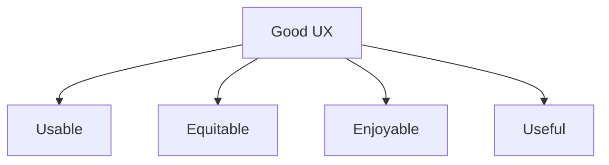
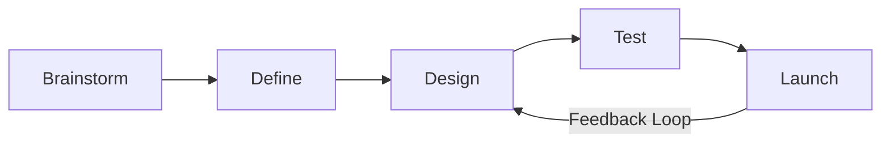

# [Google UXDesign-Professional-Certificate](https://www.coursera.org/professional-certificates/google-ux-design)

# 1.	Foundations of User Experience (UX) Design
Learn UX basics: user-centered design, accessibility, design thinking, sprint processes, personas, wireframing, and prototyping.

## What is User Experience (UX)?
- **UX** = how a person feels when interacting with a product (goods, services, features).  
- Products can be physical (e.g., potato chips, video game controller) or digital (e.g., apps, websites, smartwatches).

---

## What Makes a Good User Experience?

## 1. Usable
- Design, structure, and purpose are **clear and easy to use**.  
- **Key questions:**  
  - Is everything easy to find?  
  - Can users understand functionality?  
  - Can tasks be completed easily?  
- *Example:* An airline app with a simple homepage to enter flight details.  

---

## 2. Equitable
- Design is **helpful to people with diverse abilities and backgrounds**.  
- Goes beyond equality → provides different tools/support based on user needs.  
- **Key questions:**  
  - Are diverse users’ needs considered?  
  - Does it support underrepresented groups?  
- *Example:* A messaging app with skin tone emojis and gender-neutral avatars.  

---

## 3. Enjoyable
- Design **delights the user** and creates a positive emotional connection.  
- Enhances a functional product by adding delight and engagement.  
- **Key questions:**  
  - Does it reflect user feelings?  
  - Does it inspire delight and engagement?  
- *Example:* A streaming app with personalized recommendations and customization options.  

---

## 4. Useful
- Design **solves user problems** directly and adds value.  
- Different from usability:  
  - *Usable* = easy to use.  
  - *Useful* = solves the right problem.  
- **Key questions:**  
  - Does it solve a problem?  
  - Does it help users achieve goals?  
- *Example:* A banking app with features to transfer money and pay bills.  

---

## Why UX Matters to Business
- Companies with good usability and design outperform competitors  
- Positive UX leads to:  
  - More frequent use of the product.  
  - Word-of-mouth recommendations.  
  - Stronger brand reputation.  
- Good UX benefits both the **user** (satisfaction, ease, joy) and the **business** (growth, loyalty, revenue).  

---

## Role of UX Designers
- Understand and address the needs of diverse users.  
- Conduct research to learn how users experience products.  
- Improve usability, equity, enjoyment, and usefulness.  
- Educate businesses on the value of UX in driving success.  

---

## ✅ Key takeaway
A well-designed user experience makes products **usable, equitable, enjoyable, and useful** — benefiting both people and businesses.

---

## Product Development Life Cycle (PDLC)

Every product (app or physical object) goes through **five stages**:  
**Brainstorm → Define → Design → Test → Launch**.  
The process isn’t always linear — teams may revisit earlier stages based on feedback.  

---

## 1. Brainstorm
- Generate ideas for solving user problems.  
- Diversity in the team brings broader perspectives.  
- Research users and competitors to identify real needs and market gaps.  
- *Example:* Brainstorming problems working parents face (childcare, scheduling, transportation).  
- **UX role:**  
  - Larger companies → minimal involvement.  
  - Startups → significant role.  

---

## 2. Define
- Narrow focus and **specify what the product will do**.  
- **Key questions:** Who is the product for? What will it do? What features are essential?  
- One product can’t solve every problem → scope is set by product leads.  
- UX designers help refine focus and ensure user research informs decisions.  
- *Example:* Parenting app focuses on **childcare OR scheduling**, not both.  

---

## 3. Design
- UX designers create:  
  - **Wireframes** (sketches of layout).  
  - **Prototypes** (early models to show functionality).  
- UX writers contribute button labels and copy.  
- Ensure:  
  - Product specifications are included.  
  - Flows are intuitive.  
  - Every interaction has a clear result.  
- Applies to both **digital** (app screens flow logically) and **physical** (product parts fit together).  

---

## 4. Test
- Develop functional prototypes and run multiple testing phases:  
  1. **Internal testing (alpha):** usability + technical issues.  
  2. **Stakeholder testing:** company vision, accessibility, legal, privacy compliance.  
  3. **User testing (beta):** is the product usable, equitable, enjoyable, and useful?  
- Feedback is **critical** → refine or redesign if users are frustrated/confused.  
- Teams often cycle between **design ↔ test** before moving forward.  

---

## 5. Launch
- Release product publicly (app store, website live, physical shelves).  
- Activities include:  
  - Marketing & promotion (social media, press releases).  
  - Customer support preparation.  
  - Team reflection: What worked? What can improve? Were goals met?  
- For **physical products** → cycle usually ends.  
- For **digital products** → launch often reveals new issues → cycle back to **design & test**.  

---

## ✅ Key Takeaways
- The PDLC is **iterative**: products often cycle between stages.  
- UX designers are most active in **design** but collaborate throughout.  
- Success depends on completing each stage carefully before moving forward.  
- Every product you use has gone through this process — recognizing it helps you think like a UX designer.

---

## Common Traits of UX Designers
- Come from **diverse backgrounds** (marketing, teaching, retail, art, etc.).  
- Share common skills & interests rather than similar work histories.  
- Tend to be:  
  - **Visually aware** – sense of layout, color, and balance.  
  - **Curious** – about people and how they think.  
  - **Empathetic** – able to understand others’ feelings and perspectives.  
  - **Resourceful** – often self-taught or leveraging past jobs/hobbies.  

---

## Types of UX Designers
- **Interaction Designers**  
  - Focus on product functionality and how users interact with it.  
  - Balance user needs, business goals, and technical feasibility.  
  - *Example:* designing security/privacy tools at Google.  

- **Visual Designers**  
  - Focus on **appearance** (logos, icons, fonts, colors, layouts).  

- **Motion Designers**  
  - Focus on **movement and transitions** within apps/websites.  
  - Create smooth, engaging user flows.  

- **Graphic Designers (related but different)**  
  - Work on visuals for physical/digital materials (e.g., posters, invitations).  
  - UX designers differ by focusing on **interaction** with products.  

---

## Colleagues UX Designers Work With
- **UX Researchers** – conduct studies, interviews, usability testing.  
- **UX Writers** – create clear, intuitive language (e.g., button labels, tone).  
- **Production Designers** – ensure final designs match specs; prepare assets for engineers.  
- **UX Engineers** – translate designs into working apps/websites.  
- **UX Program Managers** – coordinate communication, set goals, manage timelines.  

---

## ✅ Key Takeaway
UX design is **multidisciplinary**, with roles ranging from **interaction, visual, and motion design** to **research, writing, engineering, and management**.  
Collaboration is central: UX designers rarely work alone — they partner with researchers, writers, engineers, and managers to create smooth, user-friendly experiences.

---

## Key UX Career Paths

### Design-Focused Roles
- **Interaction Designer** – Focus on **user flow and functionality**; make products easy to navigate.  
- **Visual Designer** – Focus on **appearance** (logos, fonts, colors, layouts); ensure visual consistency.  
- **Motion Designer** – Focus on **movement and transitions**; create smooth animations and user flows.  
- **VR/AR Designer** – Create **immersive 3D experiences**; consider comfort, sound, and visuals.  

### Research & Content Roles
- **UX Researcher** – Study how people use products; identify pain points and test usability.  
- **UX Writer** – Craft clear, intuitive language; define brand voice; write button labels and app copy.  

### Collaboration & Implementation Roles
- **UX Program Manager** – Coordinate communication, set goals, manage resources and timelines.  
- **UX Engineer** – Translate designs into working apps/websites; bridge between design and development.  

### Specialized Role
- **Conversation Designer** – Build **chatbots, voice assistants, and conversational systems**; design dialog flow, tone, and personality.  

---

## Evolution of UX Tools
- Early years: **Adobe Creative Suite (Photoshop)** → mostly for print/static design.  
- **2010–2015**: Digital-first tools emerged:  
  - **Sketch (2010):** first tool built specifically for UX.  
  - **Freehand (2011)** & **Zeplin (2015):** added prototyping & collaboration.  
- **2016–Today**: Collaborative design tools dominate:  
  - **Figma (2016):** real-time collaboration, prototyping, Dev Mode, plug-ins.  
  - **Adobe XD (2016):** once popular, now in maintenance mode.  

---

## Considerations When Choosing UX Tools
1. **Who you are as a designer** – role and responsibilities (e.g., UX, visual, or motion designer).  
2. **Design context** – company standards, project needs, collaboration level.  
3. **Tool capabilities** –  
   - Mobile-responsive design.  
   - Prototyping, testing, reviewing.  
   - Team collaboration.  
   - Centralized design system for consistency.  

---

## Tool Comparison

### Sketch, Freehand, Zeplin
- Good for large teams.  
- Often paired with other tools.  
- Can be used offline.  
- Limited: no real-time collaboration or integrated prototyping.  

### Figma
- Excellent for most designers and contexts.  
- All-in-one: design, collaboration, prototyping.  
- Remote-friendly, requires WiFi.  
- Includes **FigJam** for brainstorming and whiteboarding.  

---

## ✅ Key Takeaway
UX tools have evolved from **static print design** to **collaborative, digital-first platforms**.  
- **Figma** is the leading modern tool and the focus of this certificate program.  
- Designers may use multiple tools in their careers, but choosing the right one depends on role, context, and capabilities.

---

## Stay Current with the UX Industry

The field of UX design is constantly evolving. To succeed, designers need to keep up with **tools, standards, and best practices** by engaging with thought leaders, communities, tutorials, and open-source resources.

---

### Thought Leaders in UX
- **Nielsen Norman Group** – Training, consulting, reports, and resources for UX innovation.  [Nielsen Norman Group](https://www.nngroup.com)
- **UX Collective Blog** – Curated posts, newsletters, and editor picks from UX designers worldwide.  [UX Collective Blog](https://uxdesign.cc)
- **Interaction Design Foundation** – Open-access articles, textbooks, and fee-based courses. [Interaction Design Foundation](https://www.interaction-design.org)
- **UX Planet** – Guides on fundamentals, careers, and agencies.  [UX Planet](https://uxplanet.org)
- **Growth.design** – Weekly case studies in comic-book format, focusing on psychology in UX.     [Growth.design](https://growth.design)
- **Case Study Club** – Community sharing UX case studies (28k+ members, including Google & Adobe).   [Case Study Club](https://www.casestudy.club)
- **Awwwards** – Showcases globally recognized UX designs with focus on visual elements.  [Awwwards](https://www.awwwards.com)
- **UXPodcast** – Podcast/blog exploring balance of business, tech, and society in UX.  [UXPodcast](https://uxpodcast.com/about/)
- 
---

### UX Communities
- **Creative Mornings** – Free meetups/field trips for creatives worldwide.  https://creativemornings.com
- **AIGA** – Professional Association for Design; conferences, resources, professional development.  https://www.aiga.org
- **ADPList** – Mentorship service matching aspiring designers with experienced mentors.  https://adplist.org

### Inclusive Communities
- **APIwho.design**  https://www.apiwho.design
- **Blacks Who Design**  https://blackswho.design
- **Ladies that UX**  https://ladiesthatux.com
- **Latinxs Who Design**  https://www.latinxswhodesign.com
- **Techqueria (Latinx in Tech)**  https://techqueria.org
- **Women Who Design**  https://womenwho.design
- **Queer Design Club**  https://www.queerdesign.club

---

### Tool-Hosted Tutorials
- **Figma** – Help Center, Beginner Guides, YouTube channel.
    - https://help.figma.com/hc/en-us
    - https://help.figma.com/hc/en-us/categories/360002051613
    - https://help.figma.com/hc/en-us/sections/30880632542743
    - https://www.youtube.com/@figma
- **Sketch, Freehand, Zeplin** – Docs, 101 guides, start guides.
    - https://www.sketch.com/docs/
    - https://miro.com
    - https://support.zeplin.io/en/articles/6576801-getting-started-with-zeplin-for-designers 

---

### Creator-Made Tutorials
- Platforms: **Google, YouTube, TikTok**.  
- Offer detailed tips, walkthroughs, and problem-solving from real designers.  

---

### Open-Source Design Templates
- Provide downloadable, customizable templates to speed up design work.  
- Sources:  
  - **Figma Template Community**  https://www.figma.com/community
  - **Adobe XD UI Kits**  https://helpx.adobe.com/xd/help/access-ui-kits.html
  - **Sketch UI Kits**  https://ui8.net/category/sketch
  - **Airtable Template Community**  https://www.airtable.com/templates
  - **Miro Template Community**  https://miro.com/templates/

---

### ✅ Key Takeaway
To stay competitive in UX:  
- Follow **thought leaders** for best practices.  
- Join **communities** to network and learn.  
- Use **tutorials** (official + creator-made) to sharpen skills.  
- Experiment with **open-source templates** to accelerate design work and explore new ideas.

---

  
# 2.	Start the UX Design Process: Empathize, Define, and Ideate
Focus on early UX process steps: empathy mapping, user pain points, ideation, personas, mockups, and user flows.

---

#	3.	Build Wireframes and Low-Fidelity Prototypes
Create storyboards, paper & digital wireframes in Figma, and build low-fidelity prototypes.

---

#	4.	Conduct UX Research and Test Early Concepts
Plan and run usability studies (moderated & unmoderated), synthesize insights, and refine designs based on feedback.

---
 
#	5.	Create High-Fidelity Designs and Prototypes in Figma
Design polished mockups in Figma, build interactive prototypes, apply visual design principles, and prepare for handoff.

---

#	6.	Build Dynamic User Interfaces (UI) for Websites
Plan responsive websites, create sitemaps and wireframes, engage in design critiques, and assemble portfolio-worthy projects.

---

#	7.	Design a User Experience for Social Good & Prepare for Jobs
Develop cross-platform UX projects for social good, polish your portfolio, and prepare for interviews—including AI-enhanced tools.

---

#	8.	Accelerate Your Job Search with AI (Inferred from overview)
Leverage AI tools to streamline redesign tasks, craft compelling copy, and enhance portfolio presentation.

---


