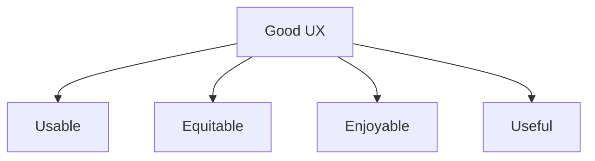
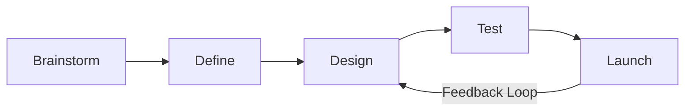

# [Google UXDesign-Professional-Certificate](https://www.coursera.org/professional-certificates/google-ux-design)

# 1.	Foundations of User Experience (UX) Design
Learn UX basics: user-centered design, accessibility, design thinking, sprint processes, personas, wireframing, and prototyping.

## What is User Experience (UX)?
- **UX** = how a person feels when interacting with a product (goods, services, features).  
- Products can be physical (e.g., potato chips, video game controller) or digital (e.g., apps, websites, smartwatches).

---

## What Makes a Good User Experience?

---

### **2. Quadrant Style**  
Shows all four as equal parts branching from UX.  

## 1. Usable
- Design, structure, and purpose are **clear and easy to use**.  
- **Key questions:**  
  - Is everything easy to find?  
  - Can users understand functionality?  
  - Can tasks be completed easily?  
- *Example:* An airline app with a simple homepage to enter flight details.  

---

## 2. Equitable
- Design is **helpful to people with diverse abilities and backgrounds**.  
- Goes beyond equality → provides different tools/support based on user needs.  
- **Key questions:**  
  - Are diverse users’ needs considered?  
  - Does it support underrepresented groups?  
- *Example:* A messaging app with skin tone emojis and gender-neutral avatars.  

---

## 3. Enjoyable
- Design **delights the user** and creates a positive emotional connection.  
- Enhances a functional product by adding delight and engagement.  
- **Key questions:**  
  - Does it reflect user feelings?  
  - Does it inspire delight and engagement?  
- *Example:* A streaming app with personalized recommendations and customization options.  

---

## 4. Useful
- Design **solves user problems** directly and adds value.  
- Different from usability:  
  - *Usable* = easy to use.  
  - *Useful* = solves the right problem.  
- **Key questions:**  
  - Does it solve a problem?  
  - Does it help users achieve goals?  
- *Example:* A banking app with features to transfer money and pay bills.  

---

## Why UX Matters to Business
- Companies with good usability and design outperform competitors  
- Positive UX leads to:  
  - More frequent use of the product.  
  - Word-of-mouth recommendations.  
  - Stronger brand reputation.  
- Good UX benefits both the **user** (satisfaction, ease, joy) and the **business** (growth, loyalty, revenue).  

---

## Role of UX Designers
- Understand and address the needs of diverse users.  
- Conduct research to learn how users experience products.  
- Improve usability, equity, enjoyment, and usefulness.  
- Educate businesses on the value of UX in driving success.  

---

## ✅ Key takeaway
A well-designed user experience makes products **usable, equitable, enjoyable, and useful** — benefiting both people and businesses.

---

## Product Development Life Cycle (PDLC)

Every product (app or physical object) goes through **five stages**:  
**Brainstorm → Define → Design → Test → Launch**.  
The process isn’t always linear — teams may revisit earlier stages based on feedback.  

---

## 1. Brainstorm
- Generate ideas for solving user problems.  
- Diversity in the team brings broader perspectives.  
- Research users and competitors to identify real needs and market gaps.  
- *Example:* Brainstorming problems working parents face (childcare, scheduling, transportation).  
- **UX role:**  
  - Larger companies → minimal involvement.  
  - Startups → significant role.  

---

## 2. Define
- Narrow focus and **specify what the product will do**.  
- **Key questions:** Who is the product for? What will it do? What features are essential?  
- One product can’t solve every problem → scope is set by product leads.  
- UX designers help refine focus and ensure user research informs decisions.  
- *Example:* Parenting app focuses on **childcare OR scheduling**, not both.  

---

## 3. Design
- UX designers create:  
  - **Wireframes** (sketches of layout).  
  - **Prototypes** (early models to show functionality).  
- UX writers contribute button labels and copy.  
- Ensure:  
  - Product specifications are included.  
  - Flows are intuitive.  
  - Every interaction has a clear result.  
- Applies to both **digital** (app screens flow logically) and **physical** (product parts fit together).  

---

## 4. Test
- Develop functional prototypes and run multiple testing phases:  
  1. **Internal testing (alpha):** usability + technical issues.  
  2. **Stakeholder testing:** company vision, accessibility, legal, privacy compliance.  
  3. **User testing (beta):** is the product usable, equitable, enjoyable, and useful?  
- Feedback is **critical** → refine or redesign if users are frustrated/confused.  
- Teams often cycle between **design ↔ test** before moving forward.  

---

## 5. Launch
- Release product publicly (app store, website live, physical shelves).  
- Activities include:  
  - Marketing & promotion (social media, press releases).  
  - Customer support preparation.  
  - Team reflection: What worked? What can improve? Were goals met?  
- For **physical products** → cycle usually ends.  
- For **digital products** → launch often reveals new issues → cycle back to **design & test**.  

---

## ✅ Key Takeaways
- The PDLC is **iterative**: products often cycle between stages.  
- UX designers are most active in **design** but collaborate throughout.  
- Success depends on completing each stage carefully before moving forward.  
- Every product you use has gone through this process — recognizing it helps you think like a UX designer.
---
  
# 2.	Start the UX Design Process: Empathize, Define, and Ideate
Focus on early UX process steps: empathy mapping, user pain points, ideation, personas, mockups, and user flows.

---

#	3.	Build Wireframes and Low-Fidelity Prototypes
Create storyboards, paper & digital wireframes in Figma, and build low-fidelity prototypes.

---

#	4.	Conduct UX Research and Test Early Concepts
Plan and run usability studies (moderated & unmoderated), synthesize insights, and refine designs based on feedback.

---
 
#	5.	Create High-Fidelity Designs and Prototypes in Figma
Design polished mockups in Figma, build interactive prototypes, apply visual design principles, and prepare for handoff.

---

#	6.	Build Dynamic User Interfaces (UI) for Websites
Plan responsive websites, create sitemaps and wireframes, engage in design critiques, and assemble portfolio-worthy projects.

---

#	7.	Design a User Experience for Social Good & Prepare for Jobs
Develop cross-platform UX projects for social good, polish your portfolio, and prepare for interviews—including AI-enhanced tools.

---

#	8.	Accelerate Your Job Search with AI (Inferred from overview)
Leverage AI tools to streamline redesign tasks, craft compelling copy, and enhance portfolio presentation.

---


